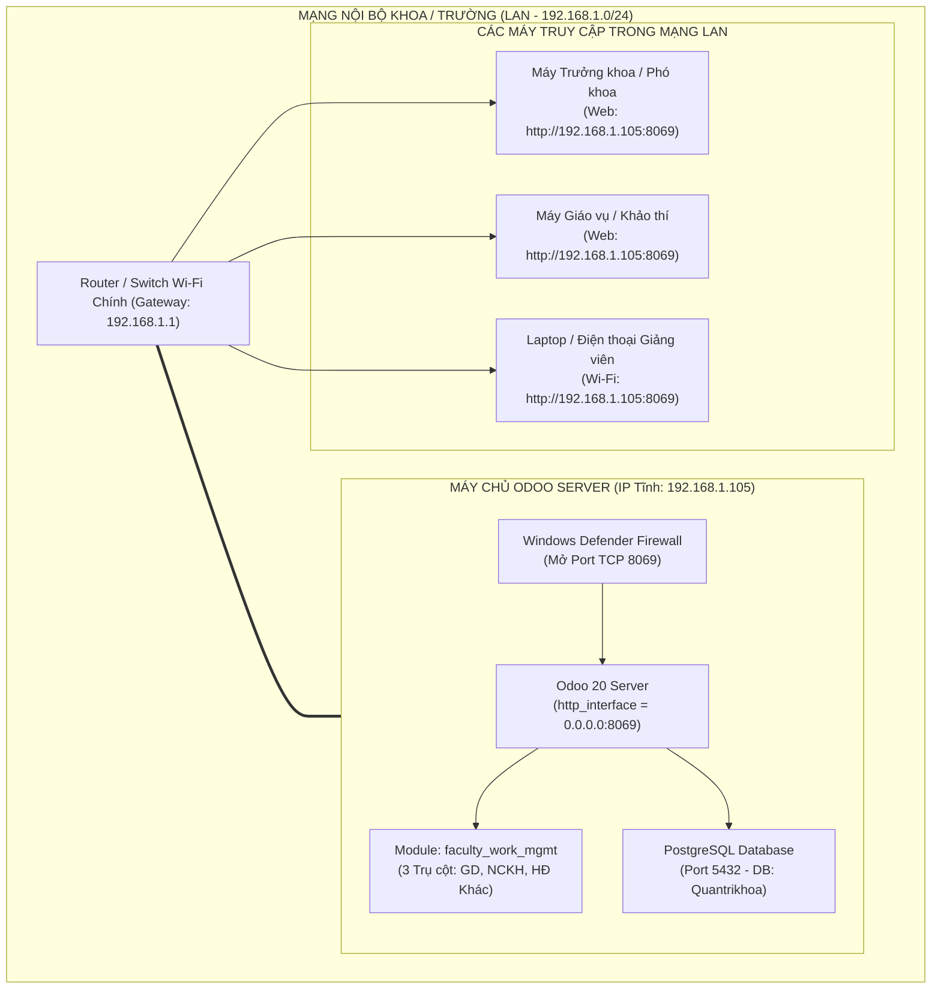

# CẨM NANG KỸ THUẬT ODOO SENIOR: TRIỂN KHAI ODOO 20 QUA MẠNG LAN & CÀI ĐẶT MODULE QUẢN LÝ KHOA ĐÀO TẠO

> **Tài liệu được biên soạn bởi Odoo Senior Solution Architect**, dành cho cán bộ quản trị CNTT, giáo vụ và lãnh đạo khoa để thiết lập hệ thống thử nghiệm nội bộ nhanh chóng, an toàn, ổn định mà không cần mua domain hay thuê Cloud server.
>
> 📁 **File Word (.docx) đính kèm sẵn sàng in ấn/gửi nội bộ**: [Huong_dan_cai_dat_va_trien_khai_Odoo_20_LAN.docx](file:///d:/odoo_faculty_workspace/Huong_dan_cai_dat_va_trien_khai_Odoo_20_LAN.docx)

---

## MỤC LỤC
1. [Mô hình Kiến trúc & Yêu cầu Môi trường Mạng LAN](#phần-1-mô-hình-kiến-trúc--yêu-cầu-môi-trường-mạng-lan)
2. [Cài đặt Odoo 20 & Cấu hình then chốt trong file `odoo.conf`](#phần-2-cài-đặt-odoo-20--cấu-hình-then-chốt-trong-file-odooconf)
3. [Mở cổng Firewall 8069 & Xác định IP Máy chủ](#phần-3-mở-cổng-tường-lửa-port-8069--xác-định-ip-máy-chủ)
4. [Cài đặt & Triển khai Module Khoa Đào tạo (`faculty_work_mgmt`)](#phần-4-cài-đặt--triển-khai-module-khoa-đào-tạo-faculty_work_mgmt)
5. [Cập nhật Ngôn ngữ Tiếng Việt Thủ công cho Toàn hệ thống](#phần-5-cập-nhật-ngôn-ngữ-tiếng-việt-thủ-công-cho-toàn-hệ-thống)
6. [Cẩm nang Xử lý Sự cố Kinh điển (Troubleshooting Guide)](#phần-6-cẩm-nang-xử-lý-sự-cố-kinh-điển-troubleshooting-guide)

---

## PHẦN 1: MÔ HÌNH KIẾN TRÚC & YÊU CẦU MÔI TRƯỜNG MẠNG LAN



### Bảng cấu hình phần cứng khuyến nghị cho Server mạng LAN

| Thành phần | Cấu hình Thử nghiệm (Dưới 10 máy) | Cấu hình Chạy Khoa (20 - 50 máy) |
|:---|:---|:---|
| **Hệ điều hành** | Windows 10/11 64-bit | Windows 11 Pro 64-bit hoặc Ubuntu 22.04/24.04 Server |
| **CPU** | Intel Core i5 / AMD Ryzen 5 (4 Cores) | Intel Core i7 / AMD Ryzen 7 (8 Cores trở lên) |
| **RAM** | 8 GB RAM (PostgreSQL 2GB, Odoo 4GB) | 16 GB - 32 GB RAM |
| **Ổ cứng** | SSD 256 GB NVMe | SSD 512 GB NVMe (Tốc độ đọc/ghi cao cho database) |
| **Card mạng** | Wi-Fi 5 / Wi-Fi 6 | Cắm cáp mạng dây Gigabit LAN (1 Gbps) vào Router |

> [!TIP]
> **Khuyến nghị từ Senior**: Hãy cài đặt **Địa chỉ IP Tĩnh (Static IP)** cho máy chủ Odoo trong phần cài đặt card mạng (`Network & Internet Settings` -> `Properties` -> `IP assignment: Manual` -> Đặt IP ví dụ `192.168.1.105`, Subnet `255.255.255.0`, Gateway `192.168.1.1`). Việc này giúp địa chỉ truy cập không bị thay đổi mỗi khi Router Wi-Fi khởi động lại.

---

## PHẦN 2: CÀI ĐẶT ODOO 20 & CẤU HÌNH THEN CHỐT TRONG FILE `ODOO.CONF`

### 2.1. Cài đặt Odoo 20 trên máy chủ
1. Tải bản cài đặt Odoo 20 chính thức dành cho Windows (.exe).
2. Chạy file cài đặt với quyền **Run as Administrator**.
3. Tại bước chọn thành phần: Tích chọn cả hai mục **Odoo Server** và **PostgreSQL Database**.
4. Cấu hình thông tin kết nối CSDL (User: `odoo`, Password: tự đặt, Host: `localhost`, Port: `5432`).
5. Đường dẫn cài đặt mặc định thông thường: `C:\Program Files\Odoo 20.0.xxxxxxxx\server`.

### 2.2. Tinh chỉnh cấu hình mạng trong `odoo.conf` (Quyết định khả năng truy cập LAN)
Mở file `C:\Program Files\Odoo 20.0.xxxxxxxx\server\odoo.conf` bằng Notepad (Run as Administrator) và cấu hình các dòng sau:

```ini
[options]
; ==============================================================================
; THAM SỐ QUYẾT ĐỊNH CHO PHÉP MẠNG LAN KẾT NỐI:
; Mặc định Odoo có thể gắn với 127.0.0.1 (chỉ máy cục bộ).
; Bắt buộc đổi sang 0.0.0.0 để lắng nghe trên mọi card mạng LAN/Wi-Fi.
; ==============================================================================
http_interface = 0.0.0.0
http_port = 8069

; Khai báo đường dẫn thư mục Addons của Odoo và thư mục chứa module Khoa đào tạo
addons_path = C:\Program Files\Odoo 20.0.20260927\server\odoo\addons,D:\odoo_faculty_workspace

; Cấu hình kết nối CSDL PostgreSQL
db_host = localhost
db_port = 5432
db_user = odoo
db_password = your_postgresql_password

; Mật khẩu Master bảo vệ trang quản lý CSDL (/web/database/manager)
admin_passwd = MatKhauQuanTriCSDL_CapCao_2026

; Thư mục lưu trữ tệp đính kèm nội bộ (Filestore)
data_dir = C:\Users\Administrator\AppData\Local\OpenERP S.A.\Odoo
```

> [!IMPORTANT]
> Nếu tham số `http_interface = 127.0.0.1`, Odoo sẽ **từ chối mọi kết nối từ bên ngoài**. Khi đổi thành `http_interface = 0.0.0.0`, Odoo sẽ mở cửa cho tất cả máy tính có cùng dải mạng LAN truy cập.

---

## PHẦN 3: MỞ CỔNG TƯỜNG LỬA (PORT 8069) & XÁC ĐỊNH IP MÁY CHỦ

### 3.1. Mở cổng 8069 trên Windows Defender Firewall

#### Cách 1: Sử dụng 1 lệnh PowerShell duy nhất (Khuyến nghị - Nhanh nhất)
Nhấp chuột phải vào nút Start -> chọn **Terminal (Admin)** hoặc **PowerShell (Admin)** và dán lệnh:

```powershell
New-NetFirewallRule -DisplayName "Odoo Server Port 8069" `
    -Direction Inbound `
    -LocalPort 8069 `
    -Protocol TCP `
    -Action Allow `
    -Profile Any `
    -Description "Cho phep cac may trong mang LAN truy cap he thong Odoo ERP"
```

#### Cách 2: Thao tác đồ họa qua Windows Defender Firewall with Advanced Security
1. Nhấn `Windows + R`, gõ `wf.msc` và nhấn `Enter`.
2. Chọn **Inbound Rules** ở cây thư mục bên trái.
3. Ở cột bên phải **Actions**, chọn **New Rule...**.
4. **Rule Type**: Chọn **Port** $\rightarrow$ Next.
5. **Protocol and Ports**: Chọn **TCP**, tại mục **Specific local ports** nhập: `8069` $\rightarrow$ Next.
6. **Action**: Chọn **Allow the connection** $\rightarrow$ Next.
7. **Profile**: Tích chọn cả 3 ô: **Domain**, **Private**, **Public** $\rightarrow$ Next.
8. **Name**: Nhập `Odoo Server Port 8069`, phần Description ghi chú `Mở cổng Odoo mạng LAN` $\rightarrow$ Nhấn **Finish**.

### 3.2. Lấy địa chỉ IP máy chủ để phát cho các máy khách
Tại cửa sổ PowerShell của máy chủ, gõ:
```powershell
ipconfig
```
Tìm dòng `IPv4 Address` tại card mạng đang kết nối. Ví dụ: `192.168.1.105`.

**Cách truy cập từ máy tính khác trong khoa**:
- Mở trình duyệt Web (Chrome, Edge, Safari, Cốc Cốc) trên bất kỳ máy nào cùng Wi-Fi/mạng dây:
  $$\text{http://192.168.1.105:8069}$$
- Hoặc truy cập bằng Computer Name:
  $$\text{http://TEN-MAY-CHU:8069}$$

---

## PHẦN 4: CÀI ĐẶT & TRIỂN KHAI MODULE KHOA ĐÀO TẠO (`FACULTY_WORK_MGMT`)

### Bước 4.1: Đặt mã nguồn module vào Addons
Copy toàn bộ thư mục `faculty_work_mgmt` vào thư mục addons đã khai báo trong `odoo.conf`:
- Đường dẫn đích: `C:\Program Files\Odoo 20.0.20260927\server\odoo\addons\faculty_work_mgmt`
- Hoặc thư mục workspace: `D:\odoo_faculty_workspace\faculty_work_mgmt`

### Bước 4.2: Khởi động lại Odoo Service
Để Odoo nạp cấu trúc module mới:
```powershell
# Chạy với quyền Administrator:
Restart-Service odoo-server-20.0
# Hoặc chạy file: restart_odoo.bat
```

### Bước 4.3: Kích hoạt Developer Mode và Cập nhật danh sách ứng dụng
1. Đăng nhập Odoo bằng tài khoản Administrator (`http://localhost:8069` hoặc `http://192.168.1.105:8069`).
2. Vào **Cài đặt (Settings)** $\rightarrow$ Cuộn xuống cuối trang chọn **Kích hoạt chế độ nhà phát triển (Activate the developer mode)**.
3. Vào menu **Ứng dụng (Apps)** trên thanh đầu trang.
4. Chọn menu con **Cập nhật danh sách ứng dụng (Update Apps List)** $\rightarrow$ Nhấn **Cập nhật (Update)**.
5. Trên thanh tìm kiếm, **bấm dấu X để xóa bộ lọc "Apps" mặc định**.
6. Gõ từ khóa `faculty` hoặc `Quản lý Khoa Đào tạo`.
7. Nhấn nút **Kích hoạt (Activate / Install)** trên card module.

### Bước 4.4: Nạp 100% dữ liệu mẫu thử nghiệm Khoa Kinh tế - HVNN
Chạy script tự động tạo dữ liệu mẫu đã được tích hợp sẵn:
```powershell
& "C:\Program Files\Odoo 20.0.20260927\python\python.exe" "C:\Program Files\Odoo 20.0.20260927\server\odoo\addons\faculty_work_mgmt\data\scripts\populate_vnua_data.py"
```
Toàn bộ 28 bảng dữ liệu, 4 kịch bản tính giờ chuẩn, 10 hồ sơ giảng viên, lịch giảng, đề thi và checklist sẽ được khởi tạo hoàn tất.

---

## PHẦN 5: CẬP NHẬT NGÔN NGỮ TIẾNG VIỆT 100% OFFLINE TRONG MẠNG LAN CÁCH LY

> [!WARNING]
> **Vấn đề cốt lõi khi không có Internet**: Trong giao diện chuẩn Odoo, khi bạn bấm vào nút **"Tải bản dịch" (Load a Translation)**, Odoo sẽ cố gắng gửi yêu cầu HTTP ra bên ngoài tới máy chủ Transifex / GitHub để kiểm tra phiên bản mới nhất. Khi máy chủ nằm trong mạng LAN cách ly không có kết nối Internet (Air-gapped), yêu cầu này sẽ bị treo (hang) 1 - 2 phút và ném ra lỗi `urllib3.exceptions.MaxRetryError` hoặc `Connection timed out`.

### Bí mật Kỹ thuật của Odoo Senior:
Trong chính bộ cài đặt Odoo 20 cục bộ trên máy tính của bạn (`C:\Program Files\Odoo 20.0.xxxxxxxx\server\odoo\addons`), **mỗi module nền tảng (`base`, `web`, `mail`, `calendar`, `board`...) ĐÃ ĐƯỢC ĐÓNG GÓI SẴN file dịch `i18n/vi.po` đi kèm**! 
Do đó, bạn hoàn toàn có thể kích hoạt và nạp tiếng Việt 100% ngoại tuyến mà không cần kết nối mạng Internet.

---

### Cách 1: Chạy Script tự động 1-Click Offline (Khuyên dùng - Nhanh nhất)
Hệ thống đã viết sẵn file kịch bản tự động [install_vietnamese_offline.py](file:///d:/odoo_faculty_workspace/faculty_work_mgmt/data/scripts/install_vietnamese_offline.py). Script này kích hoạt trực tiếp mã ngôn ngữ `vi_VN` trong CSDL, quét và nạp toàn bộ các file `vi.po` có sẵn trên ổ đĩa vào PostgreSQL trong 10 giây, đồng thời chuyển đổi giao diện tài khoản `admin` sang Tiếng Việt:

Mở PowerShell trên máy chủ và chạy lệnh:
```powershell
& "C:\Program Files\Odoo 20.0.20260927\python\python.exe" `
  "C:\Program Files\Odoo 20.0.20260927\server\odoo\addons\faculty_work_mgmt\data\scripts\install_vietnamese_offline.py"
```

---

### Cách 2: Kích hoạt thủ công qua giao diện Web Odoo (Không kết nối Internet)
Nếu muốn thao tác trực tiếp trên giao diện trình duyệt:
1. Đăng nhập Odoo với quyền Administrator, bật **Chế độ nhà phát triển (Developer Mode)**.
2. Vào **Cài đặt (Settings)** $\rightarrow$ **Dịch thuật (Translations)** $\rightarrow$ **Ngôn ngữ (Languages)**.
3. Trên thanh tìm kiếm, nhấp vào bộ lọc và chọn **"Không hoạt động" (Inactive)**.
4. Tìm dòng ngôn ngữ **`Vietnamese / Tiếng Việt`** (mã `vi_VN`, đang ở trạng thái `Active = False`).
5. Nhấp vào bản ghi để mở form chi tiết, tích chọn ô **`Đang hoạt động (Active = True)`** rồi bấm **Lưu (Save)**.
6. ⚠️ **Tuyệt đối KHÔNG bấm nút "Tải bản dịch" (Load a Translation)** vì nút này sẽ kích hoạt kết nối ra Internet. Thay vào đó, chuyển sang Cách 3 để nạp file PO.

---

### Cách 3: Nhập file PO dịch thuật từ USB / Đĩa rời (Import Translation)
Khi bạn có file dịch thuật tiếng Việt (ví dụ copy file `vi.po` từ máy có mạng hoặc lấy file `vi.po` có sẵn trong thư mục máy chủ):
1. Vào **Cài đặt (Settings)** $\rightarrow$ **Dịch thuật (Translations)** $\rightarrow$ **Nhập bản dịch (Import Translation)**.
2. Điền thông tin vào form:
   - **Tên ngôn ngữ**: `Vietnamese / Tiếng Việt`
   - **Mã ngôn ngữ (Code)**: `vi_VN`
   - **Tệp bản dịch (File)**: Bấm *Chọn tệp (Choose file)* và trỏ tới file `vi.po` lấy từ thư mục cài đặt cục bộ:  
     `C:\Program Files\Odoo 20.0.20260927\server\odoo\addons\base\i18n\vi.po`  
     hoặc file `vi_VN.po` của module Khoa đào tạo.
   - **Tích chọn ô**: `Ghi đè thuật ngữ hiện tại (Overwrite Existing Terms)`.
3. Bấm nút **Nhập (Import)**. Toàn bộ chuỗi ngôn ngữ sẽ được nạp trực tiếp vào CSDL PostgreSQL nội bộ.

---

### Cách 4: Đổi ngôn ngữ người dùng & Lưu ý Font chữ tiếng Việt khi in PDF
- **Đổi ngôn ngữ hiển thị người dùng**: Nhấp vào ảnh đại diện góc trên cùng bên phải $\rightarrow$ **Tùy chọn (Preferences)** $\rightarrow$ Đổi Ngôn ngữ sang `Vietnamese / Tiếng Việt` $\rightarrow$ Bấm **Lưu (Save)**.
- **Lưu ý Font tiếng Việt khi in báo cáo PDF (`wkhtmltopdf`)**: Trong môi trường mạng LAN không có Internet, khi in báo cáo kết quả thi hoặc quyết định phân công ra file PDF, nếu bị lỗi ô vuông hoặc mất dấu tiếng Việt, hãy đảm bảo Windows Server đã có sẵn các font chữ chuẩn Unicode như **Arial**, **Times New Roman**, **Tahoma** (mặc định luôn có sẵn trong thư mục `C:\Windows\Fonts`). Odoo và trình tạo PDF `wkhtmltopdf` sẽ tự động sử dụng bộ font hệ thống này.

---

## PHẦN 6: CẨM NANG XỬ LÝ SỰ CỐ KINH ĐIỂN (TROUBLESHOOTING GUIDE)

| Triệu chứng lỗi | Nguyên nhân gốc rễ | Cách xử lý dứt điểm từ Senior |
|:---|:---|:---|
| **Máy con báo `ERR_CONNECTION_TIMED_OUT`** | Tường lửa Windows chặn cổng 8069 hoặc Router bật AP Isolation | 1. Tạm thời tắt thử Firewall để xác định nguyên nhân.<br>2. Chạy lệnh mở Inbound Rule ở Phần 3.<br>3. Kiểm tra Router Wi-Fi: tắt tính năng "AP Isolation / Client Isolation" để các máy trong mạng Wi-Fi nhìn thấy nhau. |
| **Máy con báo `ERR_CONNECTION_REFUSED`** | Odoo Server đang không chạy, hoặc `http_interface` gán `127.0.0.1` | 1. Kiểm tra service Odoo đã Start chưa.<br>2. Mở file `odoo.conf`, sửa thành `http_interface = 0.0.0.0` và khởi động lại Odoo. |
| **Không tìm thấy module `faculty_work_mgmt`** | Chưa cập nhật danh sách ứng dụng hoặc còn bộ lọc "Apps" | 1. Vào Apps, bấm **xóa chữ "Apps" trên thanh Search**.<br>2. Bấm vào menu **Update Apps List** $\rightarrow$ **Update**.<br>3. Kiểm tra thư mục module không bị lồng 2 cấp (`addons/faculty_work_mgmt/faculty_work_mgmt`). |
| **Lỗi `Address already in use` (Errno 10048)** | Trùng cổng 8069 do Service ngầm và lệnh Terminal cùng chạy | Vào Task Manager $\rightarrow$ Services $\rightarrow$ Dừng dịch vụ `odoo-server-20.0` trước khi chạy lệnh Terminal, hoặc gõ: `Get-Process python \| Stop-Process -Force`. |
| **Lỗi phân quyền: `Bạn không có quyền truy cập...`** | Chưa gán quyền trong `ir.model.access.csv` | Kiểm tra file `security/ir.model.access.csv`. Đảm bảo nhóm `base.group_user` có quyền đọc (`1,0,0,0`) và user được tích chọn vai trò "Quản trị Khoa" trong Cài đặt $\rightarrow$ Người dùng. |
| **Tiếng Việt hiển thị lẫn lộn tiếng Anh** | Bộ nhớ đệm trình duyệt (Cache) lưu giao diện cũ | 1. Chạy lệnh `--i18n-overwrite` ở Bước 5.3.<br>2. Trên trình duyệt máy khách, nhấn tổ hợp phím **Ctrl + Shift + R** (hoặc Cmd + Shift + R trên Mac) để xóa cache giao diện. |

---

### Tổng kết đường dẫn file tài liệu & mã nguồn

- **File Word (.docx) hoàn chỉnh**: [Huong_dan_cai_dat_va_trien_khai_Odoo_20_LAN.docx](file:///d:/odoo_faculty_workspace/Huong_dan_cai_dat_va_trien_khai_Odoo_20_LAN.docx)
- **Mã nguồn Module hoàn chỉnh**: [faculty_work_mgmt](file:///d:/odoo_faculty_workspace/faculty_work_mgmt)
- **Gói cài đặt nén (.zip)**: [faculty_work_mgmt.zip](file:///d:/odoo_faculty_workspace/faculty_work_mgmt.zip)
- **Kịch bản nạp dữ liệu mẫu**: [populate_vnua_data.py](file:///d:/odoo_faculty_workspace/faculty_work_mgmt/data/scripts/populate_vnua_data.py)
